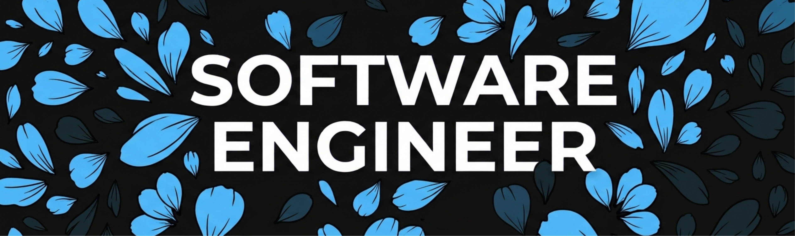

<!-- Banner Principal con Soporte Estilizado -->

  

  

 

<!-- Sección Quién Soy: Tarjeta Moderna sin Tablas Tradicionales -->

  <table width="100%" style="border: none; background: transparent;">
    <tr>
      <td width="62%" valign="top" style="border: none; padding-right: 20px;">
        <h2 style="margin-top: 0; color: #58a6ff;">👋 Hello, I'm Luis Eduardo Gutiérrez Arias</h2>
        

          I am a <strong>Software Engineer</strong> specializing in full-stack web applications, proficient in both backend and frontend development Mexico. I am <strong>21 years old</strong>, self-taught, hard-working, and deeply passionate about technology, constant evolution, and everything related to Artificial Intelligence.
        

        

          Currently, I am intensely focusing on expanding my expertise in AI engineering, with aspirations to pursue a master's degree abroad. My goal is to build scalable, high-performance solutions while continuously pushing the boundaries of what web platforms can achieve.
        

        

          This profile serves as a brief introduction. Feel free to explore my full background, professional experience, and achievements via my links below!
        

      </td>
      <td width="38%" align="center" valign="middle" style="border: none;">
        <!-- Marco Moderno para la Selfie -->
        

           
          JUNIOR FULL STACK Mexico
        

      </td>
    </tr>
  </table>

 

<!-- Sección de Tecnologías: Contenedor con Diseño Limpio -->

  <h3 style="color: #58a6ff; margin-bottom: 15px;">🎯 &nbsp;Tech Stack & Tools</h3>
  
  
LANGUAGES & FRAMEWORKS

  
  
  
TOOLS & INFRASTRUCTURE

  

 

<!-- Sección de Proyectos Destacados (Estilo Tarjetas Modernas) -->

  <h2 style="color: #58a6ff; margin-top: 0;">🚀 Featured Projects</h2>
  

    Here are a few selected projects that showcase my experience building full-stack web solutions. For a deeper look, check out my <a href="https://tu-portafolio.com" style="color: #58a6ff;">Portfolio</a> or <a href="https://linkedin.com/in/tu-linkedin" style="color: #58a6ff;">LinkedIn</a>.
  

  <table width="100%" style="border-collapse: separate; border-spacing: 0 10px;">
    <tr style="background: #0d1117;">
      <td style="padding: 14px; border: 1px solid #30363d; border-radius: 8px 0 0 8px; width: 28%;">
        <strong style="color: #58a6ff;">VLIM TIC HR Module</strong> Mexico
      </td>
      <td style="padding: 14px; border-top: 1px solid #30363d; border-bottom: 1px solid #30363d; color: #c9d1d9; font-size: 13px; width: 52%;">
        Full-stack administrative module featuring employee records, asset tracking, permissions management, and facial recognition integration[cite: 1].
      </td>
      <td align="center" style="padding: 14px; border: 1px solid #30363d; border-radius: 0 8px 8px 0; width: 20%;">
       <!-- <a href="https://tu-portafolio.com" target="_blank" style="background: #21262d; border: 1px solid #30363d; color: #c9d1d9; padding: 6px 12px; border-radius: 6px; text-decoration: none; font-size: 12px; font-weight: bold;">View Details</a> -->
      </td>
    </tr>
    <tr style="background: #0d1117;">
      <td style="padding: 14px; border: 1px solid #30363d; border-radius: 8px 0 0 8px;">
        <strong style="color: #58a6ff;">Victoria 147 & Landeros</strong> Mexico
      </td>
      <td style="padding: 14px; border-top: 1px solid #30363d; border-bottom: 1px solid #30363d; color: #c9d1d9; font-size: 13px;">
        Development of responsive web interfaces and optimized navigation structures to elevate digital presence and client usability[cite: 1].
      </td>
      <td align="center" style="padding: 14px; border: 1px solid #30363d; border-radius: 0 8px 8px 0;">
       <!-- <a href="https://tu-portafolio.com" target="_blank" style="background: #21262d; border: 1px solid #30363d; color: #c9d1d9; padding: 6px 12px; border-radius: 6px; text-decoration: none; font-size: 12px; font-weight: bold;">View Details</a> -->
      </td>
    </tr>
    <tr style="background: #0d1117;">
      <td style="padding: 14px; border: 1px solid #30363d; border-radius: 8px 0 0 8px;">
        <strong style="color: #58a6ff;">PROYECTO STATS USER</strong>
      </td>
      <td style="padding: 14px; border-top: 1px solid #30363d; border-bottom: 1px solid #30363d; color: #c9d1d9; font-size: 13px;">
        Gamified personal metrics tracking mobile application integrating video game-style status screens, streak tracking, and leveling systems.
      </td>
      <td align="center" style="padding: 14px; border: 1px solid #30363d; border-radius: 0 8px 8px 0;">
        <!-- <a href="https://github.com/tu-usuario/proyecto-stats-user" target="_blank" style="background: #21262d; border: 1px solid #30363d; color: #c9d1d9; padding: 6px 12px; border-radius: 6px; text-decoration: none; font-size: 12px; font-weight: bold;">GitHub Repo</a> -->
      </td>
    </tr>
  </table>

